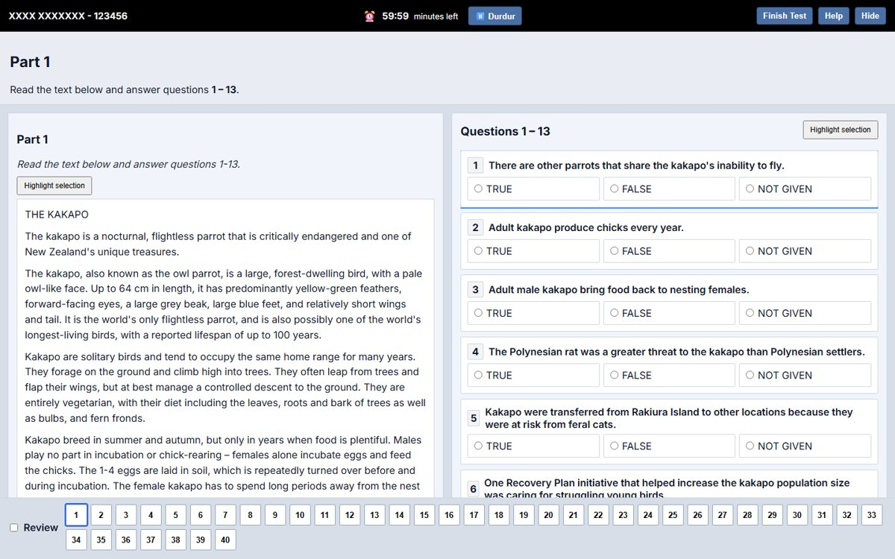
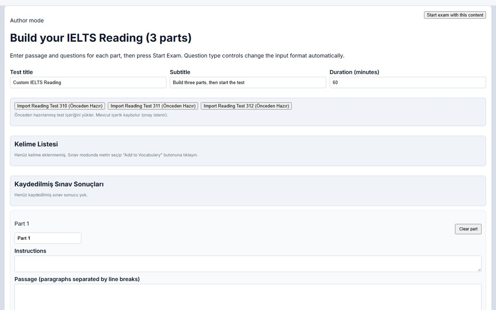

# IELTS Reading Practice

A browser app for practising the IELTS Reading test in an interface that mirrors the computer-delivered exam. You write or import a three-part test, take it against the clock, and review the scored results.



## Features

**Exam mode**
- Split view with the passage on the left and questions on the right, plus a question navigator (1–40) with "review" flags
- 60-minute countdown that can be paused
- Highlighting of selected text in passages and questions
- Seven question types: single choice, multiple choice, TRUE / FALSE / NOT GIVEN, short answer, dropdown, matching matrix and cloze
- Scored results with the correct answer for every question

**Author mode**
- Build your own test: title, duration, three parts, passages and questions. Answers for TFNG, short-answer and option lists can be added in bulk.
- Import one of three built-in tests (310–312) with one click

**Study tools** (saved in `localStorage`)
- Saved test results that you can reopen later
- Vocabulary list: select text during the exam, add a translation and context, and export as JSON, CSV or TXT



## Stack

React 19 · TypeScript · Vite 7. It runs entirely in the browser, with no backend.

```
ielts-reading/
├── src/App.tsx                 author, exam and results views
├── src/types.ts                ReadingTest / Question model
├── src/data/readingTest*.ts    built-in tests
└── parse_pdf.py, extract_pdf.py, find_answers.py
                                helpers used to turn a test PDF into src/data (pdfplumber)
```

## Running locally

```bash
cd ielts-reading
npm install
npm run dev        # http://localhost:5173
npm run build      # type-check + production build in dist/
```

## Notes

- The interface mixes English (exam UI) and Turkish (helper text and buttons).
- `npm run build` passes. `npm run lint` still reports a few rule violations (`prefer-const`, a use-before-declare in an effect, an unnecessary regex escape).
